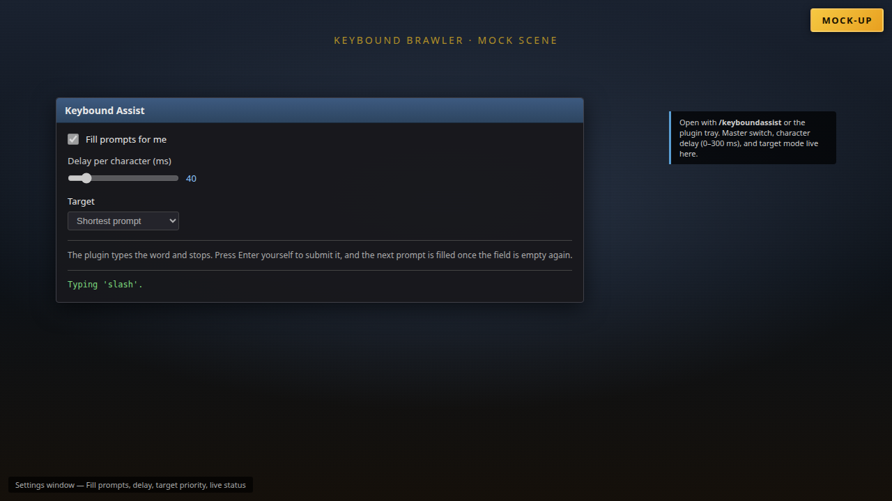
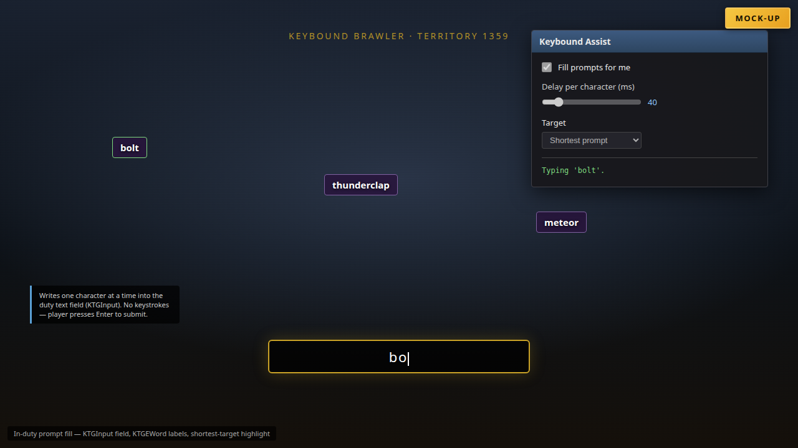
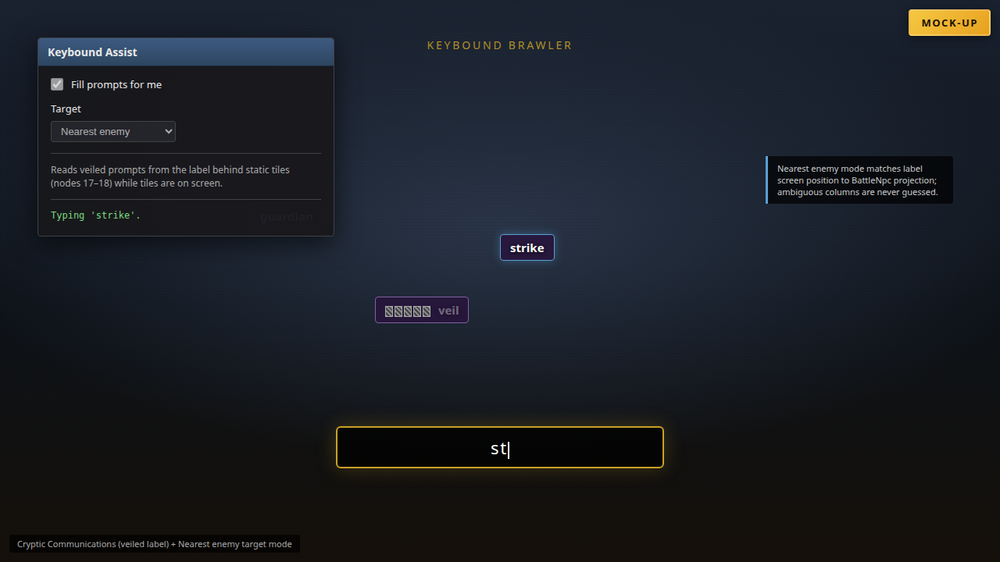
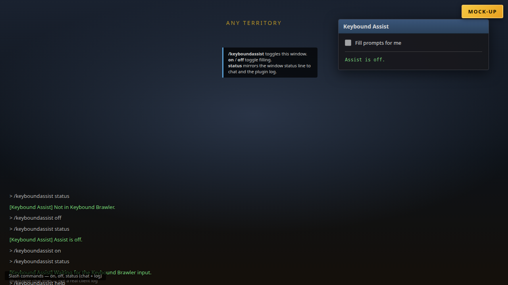
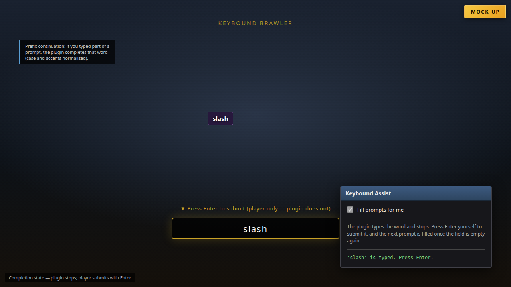

# Keybound Assist


Fills in the enemy prompts of the Keybound Brawler duty and stops; the player presses Enter to submit each word.

`/keyboundassist` · Dalamud API 15 · .NET 10

## Screenshots

These images are **mock-ups** (HTML rendered to PNG). They are not real in-game captures and do not show the actual FFXIV client UI.

| | |
| --- | --- |
|  | **Settings window** — master switch, delay range (0–1000 ms), target combo (shortest / nearest), help text, and live status line. |
|  | **Prompt fill** — enemy prompt labels and the duty input field with partial typing; status shows the active target word. |
|  | **Cryptic Communications & nearest target** — static tiles over a veiled label, nearest-enemy targeting, typing in progress. |
|  | **Commands** — `/keyboundassist status` output in chat, `on`/`off` toggles (no chat echo), and usage text for unknown args. |
|  | **Ready to submit** — full word in the field; status `'…' is typed. Press Enter.` (plugin does not submit). |

## Mock-up video

A short **mock-up** walkthrough (not real gameplay) cross-fades through the same scenes with on-screen captions. The gold **Mock-up** label stays visible for the whole clip.

- [mockup-walkthrough.mp4](docs/videos/mockup-walkthrough.mp4) (H.264, 1280×720, ~21 s)
- [mockup-walkthrough.gif](docs/videos/mockup-walkthrough.gif) (preview)

## What it does

- **Types the prompt for you** — the chosen enemy prompt is written into the duty's own text field one character at a time, the plugin then stops and leaves the word sitting there for your Enter.
- **Picks the target** — shortest visible prompt (default) or the nearest enemy; nearest falls back to the shortest prompt whenever the screen positions are ambiguous rather than guessing.
- **Finishes what you started** — if the field already holds the beginning of a prompt, it completes that word; case is ignored and accented letters are typed as their base letter.
- **Reads through Cryptic Communications** — while an enemy's word is veiled under static, the prompt is read from the label the static covers, so the word still gets typed. It is only read while that enemy's static tiles are actually on screen.
- **Never sends a keystroke** — it writes into the activity's text component in process. Your Enter is the only key pressed during a word, so nothing can land in chat.
- **Follows the duty's rules** — it does not write while the activity prohibits typing, and it will not delete or overwrite text you typed yourself.

### What it is not meant to do

- **It does not submit.** Enter is yours. There is no auto-submit option, and a word stays in the field until you press it.
- **It does not play the duty.** No movement, no registration or queueing, no run looping, no score recording, no frame-rate changes.
- **It is not an AFK bot.** It never types into a field it did not start, never clears your text, and stops dead whenever the duty locks input.
- **It does not guess.** When two enemies project to nearly the same screen column, that prompt gets no distance and is never chosen for being "nearest".
- **It does not touch chat.** It has no keyboard route at all, so there is nothing to misdirect into a chat line.

## How it works

The duty exposes both ends of the loop as game UI, so no OCR and no screen capture are involved:

| Element | Source |
| --- | --- |
| Prompt words | `KTGEWord` addon — text label (node 20) inside each enemy's component node |
| Veiled words | the same label, read while hidden and only if the static tiles (image nodes 17–18) are visible |
| Nearest enemy | label screen X/Y matched against projected `BattleNpc` positions (48 px × scale, 12 px ambiguity margin) |
| Answer field | `KTGInput` addon — text input component at node 7 |
| Typing permission | `KTGInput` `AtkValues[2]` (allowed) and `AtkValues[4]` (lock seconds), plus the component's own `Enabled` flag |

Each frame the plugin reads the field, picks the next step, and writes at most one character (`SetText`), so the field itself is always the authority on what has been typed. It only activates the field (`Focus` + `SetFocusNode`) when it is not already the active text input, so your Enter always reaches it. Outside territory 1359 it does nothing. All reads resolve their addon pointers on the frame that uses them; nothing is cached across frames.

## Commands

| Command | Effect |
| --- | --- |
| `/keyboundassist` | Open the window |
| `/keyboundassist on` / `off` | Start or stop filling prompts |
| `/keyboundassist status` | Print what the plugin currently sees, in chat and the log |

## Settings

- **Fill prompts for me** — the master switch; it is on when the plugin first loads.
- **Delay per character** — a range in milliseconds, 0–1000, default **30–60**. Every character draws a fresh delay inside that range, so the typing has no fixed cadence; set both ends to the same value for a fixed delay. 0 is one character per frame. The duty scores per submitted word, so the delay only exists to keep the field readable.
- **Target** — `Shortest prompt` or `Nearest enemy`. A prompt with no resolvable enemy always sorts last in nearest mode.

The plugin does not persist anything else. It is only active inside the duty.

## Build

Requires the .NET 10 SDK and the Dalamud dev distribution
(`%APPDATA%\XIVLauncher\addon\Hooks\dev`, or `DALAMUD_HOME`).

```
dotnet build KeyboundAssist.csproj -c Debug      # load bin/Debug/KeyboundAssist.dll as a dev plugin
dotnet build KeyboundAssist.csproj -c Release    # zip in bin/Release/KeyboundAssist/latest.zip
```

## Install (dev plugin)

1. `/xlsettings` → Experimental → Dev Plugin Locations → add `bin\Debug\KeyboundAssist.dll`.
2. `/xlplugins` → Dev Tools → enable **KeyboundAssist**.
3. Enter Keybound Brawler; `/keyboundassist` opens the window if it is not already open.

## Tests

The decision logic (`TypingPlan.cs`) and the label-to-enemy mapping (`PromptMap.cs`) carry no Dalamud or native dependency, so the harness compiles the same files into a console project and drives them with no game running: shortest-prompt choice, nearest-enemy ordering, prefix continuation, case and accent handling, text the plugin did not type, a prompt that vanishes mid-word, the typing lock, ambiguous and contested label-to-enemy matches, the saturated scale estimate, and the per-character delay draw (in range, varying, fixed when the ends are equal, swapped and out-of-range bounds tolerated, the 1000 ms cap both allowed and fixed).

```
dotnet run --project tests/KeyboundAssist.Tests.csproj -c Release    # 28 checks
```

## Limits

- **Not verified in game.** The offline checks cover the decision and mapping logic only. The native reads and the write path come from two independent live-validated plugins (XivType and Keybound Pilot) but have not been exercised on this client yet; the first real run is the test.
- **If the duty keeps the submitted word in the field**, the plugin waits rather than deleting it — clear the field yourself (Backspace) and it resumes. This is why it never clears text silently.
- The nearest-enemy match is a screen-space heuristic: labels within 48 px × scale of an enemy are matched, two enemies under 12 px apart resolve nothing, and beyond about 24 yalms the label stops carrying a distance.
- The static-reveal read trusts the label text behind the tiles. If a patch stops hiding the label there, the word simply stops being veiled — nothing breaks.
- English prompt labels only (node 20). The Japanese client shows the hiragana reading at node 22 and is not read.
- The plugin does not submit. Every word costs you one Enter.
- Territory ids and addon node ids are taken from the 7.x client; a patch that renumbers them makes the plugin wait rather than misbehave, and `/keyboundassist status` says which part is missing.

## Layout

```
Plugin.cs          entry point, command, per-frame tick, dispose
GameState.cs       KTGInput / KTGEWord reads, permission, focus, actor projection
PromptMap.cs       label→enemy matching and distance (pure, tested offline)
TypingPlan.cs      pure decision logic (compiled by the test harness)
Configuration.cs   enabled flag, character delay, target priority
AssistWindow.cs    the window
tests/             offline harness for TypingPlan.cs and PromptMap.cs
```
