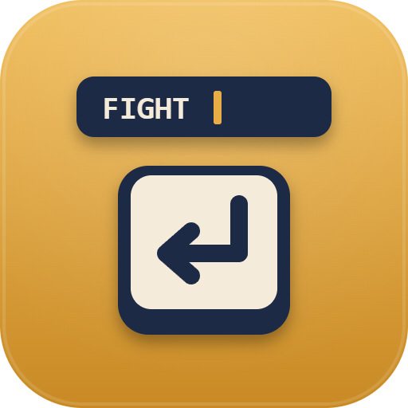
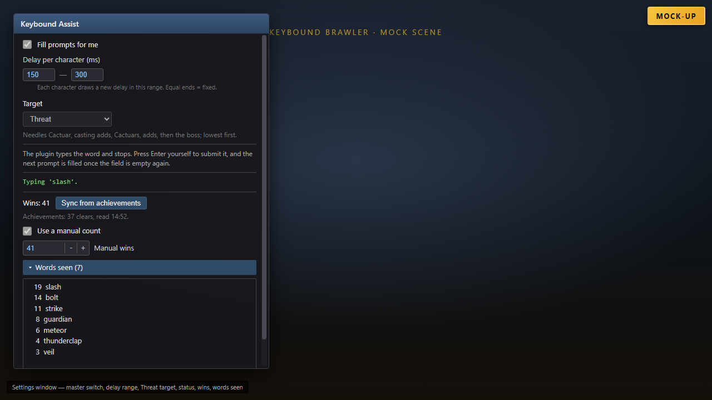
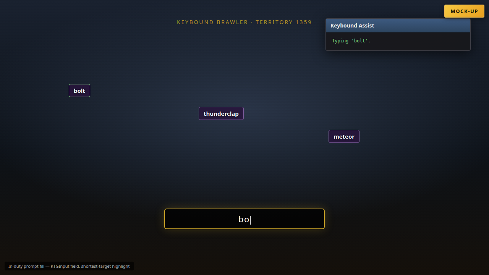
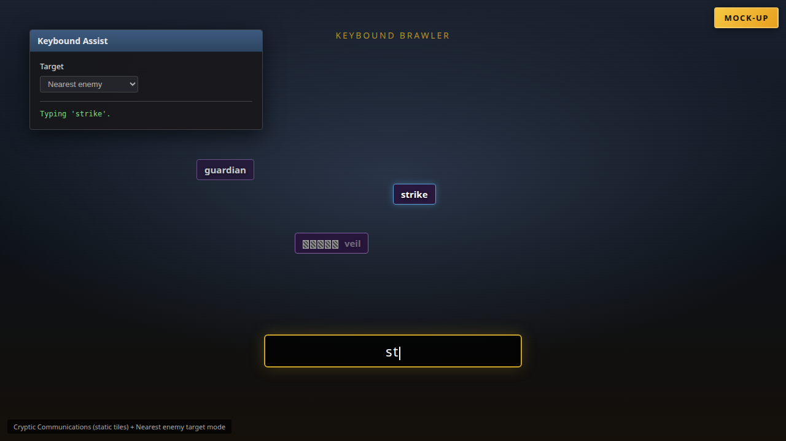
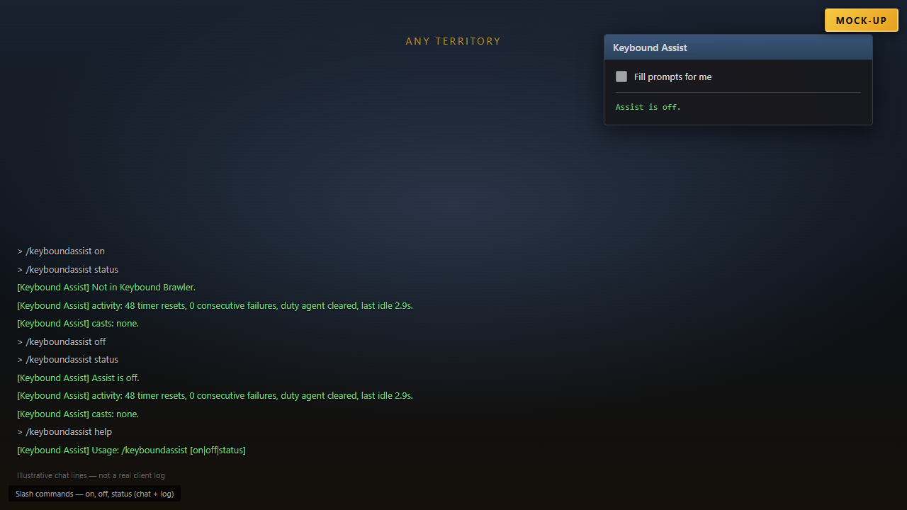
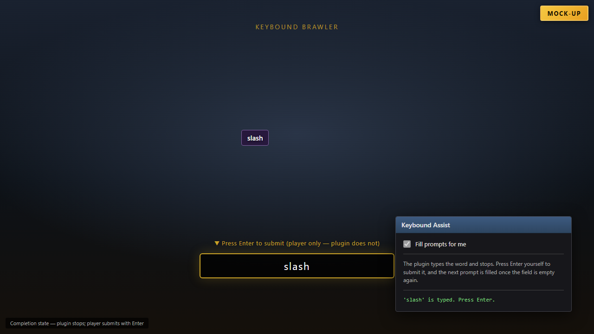
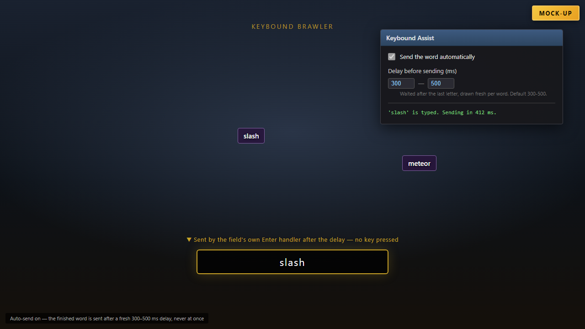
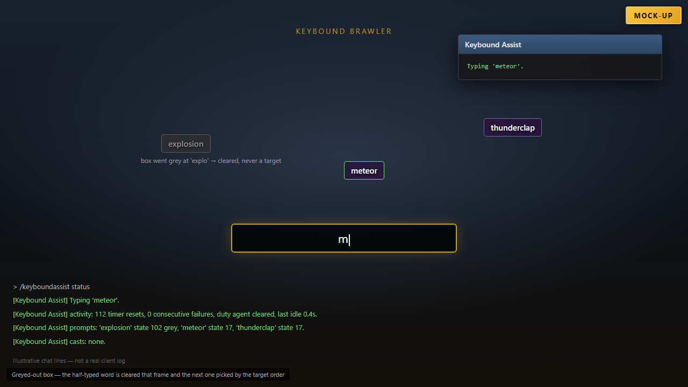

# Keybound Assist



Fills in the enemy prompts of the Keybound Brawler duty and stops; the player presses Enter to submit each word, or turns on auto-send to have it sent after a short randomised delay.

`/keyboundassist` · Dalamud API 15 · .NET 10

> [!WARNING]
> **For research use only.** Keybound Assist exists to study how the Keybound Brawler duty exposes its state to the client (prompt labels, box states, the typing lock, the input callback) and how an in-process assist can stay inside those rules. It is not a product and is not offered for general play; the source and builds are public so the work can be read and reproduced. Third-party tools break the FINAL FANTASY XIV Terms of Service; running this one on a live account is entirely at your own risk, and you alone are responsible for any action taken against that account.

> **No support will be provided. This software is to be used as is, without warranty of any kind.**

## Screenshots

These images are **mock-ups** (HTML rendered to PNG). They are not real in-game captures and do not show the actual FFXIV client UI.

| | |
| --- | --- |
|  | **Settings window** — master switch (Fill prompts for me), delay range (130–1000 ms, default 150–300), Send the word automatically with its delay range (200–2000 ms, default 300–500), target combo set to Threat with its help line, help text, live status line, wins (Sync from achievements, manual count) and the Words seen list. |
|  | **Prompt fill** — enemy prompt labels and the duty input field with partial typing; status shows the active target word. |
|  | **Cryptic Communications & nearest target** — static tiles over a veiled label, nearest-enemy targeting, typing in progress. |
|  | **Commands** — `/keyboundassist status` output in chat, `on`/`off` toggles (no chat echo), and usage text for unknown args. |
|  | **Ready to submit** — full word in the field; status `'…' is typed. Press Enter.` (auto-send off, the default: the plugin does not submit). |
|  | **Auto-send** — with the option on, the finished word waits a fresh delay drawn from 300–500 ms (status `'…' is typed. Sending in 412 ms.`), then the field's own Enter handler submits it; no key is pressed. |
|  | **Greyed-out box** — the box of the word in progress turned grey, so the half-typed text was cleared that frame and the next word is typed by the target order; `/keyboundassist status` lists each prompt's box state. |

## Mock-up video

A short **mock-up** walkthrough (not real gameplay) cross-fades through the settings, typing, Cryptic/nearest, greyed-out box, Press Enter → auto-send and chat-command scenes with on-screen beat labels and bottom captions. The gold **Mock-up** label stays visible for the whole clip.

- [mockup-walkthrough.mp4](docs/videos/mockup-walkthrough.mp4) (H.264, 1280×720, ~15 s)
- [mockup-walkthrough.gif](docs/videos/mockup-walkthrough.gif) (preview)

## What it does

- **Types the prompt for you** — the chosen enemy prompt is written into the duty's own text field one character at a time, the plugin then stops and leaves the word sitting there for your Enter.
- **Can send the word for you (off by default)** — with *Send the word automatically* on, a finished word the plugin typed is submitted through the field's own Enter callback after a fresh delay drawn per word (default **300–500 ms**, never under 200 ms), so the send never follows the last letter instantly.
- **Picks the target** — shortest visible prompt (default), the nearest enemy, or **Threat**: AutoKeyboundBrawler's kill order — a Cactuar casting Needles, then other casting adds, idle Cactuars, regular enemies, the casting boss and the idle boss, the lowest enemy on screen first within each tier. Nearest falls back to the shortest prompt whenever the screen positions are ambiguous rather than guessing.
- **Counts wins and words** — the clear count is read from the Masterstroke achievements (I–IV, ids 4070–4073); every prompt word seen in the duty is listed with how often it appeared.
- **Finishes what you started** — if the field already holds the beginning of a prompt, it completes that word; case is ignored and accented letters are typed as their base letter.
- **Reads through Cryptic Communications** — while an enemy's word is veiled under static, the prompt is read from the label the static covers, so the word still gets typed. It is only read while that enemy's static tiles are actually on screen.
- **Backspace clears what it typed** — a single Backspace over the plugin's own characters empties the field and skips that word for a moment instead of writing it straight back.
- **Keeps the duty's inactivity timer alive** — a direct write into the field is not input, so the game still counts you as idle and expels you; the plugin always clears the same counters a physical key would while you are in the duty, and still sends no keystroke.
- **Never sends a keystroke** — it writes into the activity's text component in process. Your Enter is the only key pressed during a word, so nothing can land in chat; auto-send calls the field's Enter handler directly and presses no key either.
- **Answers barrier words first** — a player defence prompt is drawn at the barrier line at the bottom of the screen, and it outranks both targeting modes; if one appears while a normal word is only half typed, the partial text is dropped and the barrier word takes over.
- **Drops a word whose box goes grey** — a greyed-out word box is never a target. If the box of the word being typed turns grey, the plugin's text is cleared on that same frame and the next word is chosen by the selected target order (a pending auto-send is cancelled with it). Only the plugin's own text and never while typing is locked; a live prompt the text still leads into is continued instead.
- **Drops a word whose enemy died** — when no prompt on screen continues the text the plugin wrote (its enemy was killed mid-word), that leftover is cleared after 0.4 s and the next word starts fresh. Only the plugin's own text, never while typing is locked; a prompt the text still leads into is continued instead.
- **Stops before the locking cast, not after** — Dynamic Sensory Jammer and Cursed Gaze are caught from whichever source sees them first — the casting enemy's own cast (its action id, read from the object table) or the enemy cast bar label — so typing pauses from the start of the cast and for 3.5 s after it resolves, instead of waiting for the field's own lock to engage.
- **Types punctuation as drawn** — "don't-stop!" is typed as `don't-stop!`; only accents are reduced to their base letter.
- **Follows the duty's rules** — it does not write while the activity prohibits typing, and it will not delete or overwrite text you typed yourself.

### What it is not meant to do

- **It does not submit unless you turn it on.** By default Enter is yours and a word stays in the field until you press it. Auto-send only ever sends a word the plugin typed itself, once, after the delay, and never while the duty, a locking cast or the chat line holds input; a word you typed is always yours to send.
- **It does not play the duty.** No movement, no registration or queueing, no run looping, no score recording (it keeps only the win count and the words seen), no frame-rate changes.
- **It is not an AFK bot.** It never types into a field it did not start, never clears your text, and stops dead whenever the duty locks input.
- **It does not guess.** When two enemies project to nearly the same screen column, that prompt gets no distance and is never chosen for being "nearest".
- **It does not touch chat.** It has no keyboard route at all, so there is nothing to misdirect into a chat line.

## How it works

The duty exposes both ends of the loop as game UI, so no OCR and no screen capture are involved:

| Element | Source |
| --- | --- |
| Prompt words | `KTGEWord` addon — text label (node 20) inside each enemy's component node |
| Veiled words | the same label, read while hidden and only if the static tiles (image nodes 17–18) are visible |
| Nearest enemy | label screen X/Y matched against projected `BattleNpc` positions (48 px × scale, 12 px ambiguity margin) |
| Greyed-out box | the box's timeline state 102 in the shipped `KTGEWord` ULD: box fill (node 26) tinted −255/−255/−255 **and** the word (node 20) drawn at alpha 204 — both are required |
| Answer field | `KTGInput` addon — text input component at node 7 |
| Typing permission | `KTGInput` `AtkValues[2]` (allowed) and `AtkValues[4]` (lock seconds), plus the component's own `Enabled` flag |
| Threat order | `CastBarEnemy` spell labels by component node id, matched to the `KTGEWord` slot with the same id; slot 2 is the boss; Cactuar words from `KTGTypeWordTextData` rows plus a `cactuar`/`tender` name match |
| Locking casts | `IBattleChara.IsCasting` + `CastActionId` on any `BattleNpc`, and the `CastBarEnemy` spell label — the first to see Dynamic Sensory Jammer or Cursed Gaze starts the hold |
| Wins | `Achievement` progress (`ProgressAchievementId`/`ProgressCurrent`/`ProgressMax`) for Masterstroke I–IV |

Each frame the plugin reads the field, picks the next step, and writes at most one character (`SetText`), so the field itself is always the authority on what has been typed. It only activates the field (`Focus` + `SetFocusNode`) when it is not already the active text input, so your Enter always reaches it. Outside territory 1359 it does nothing. All reads resolve their addon pointers on the frame that uses them; nothing is cached across frames.

## Commands

| Command | Effect |
| --- | --- |
| `/keyboundassist` | Open the window |
| `/keyboundassist on` / `off` | Start or stop filling prompts |
| `/keyboundassist status` | Print what the plugin currently sees, in chat and the log — including each prompt's box state and whether it reads as grey |

## Settings

- **Fill prompts for me** — the master switch; it is on when the plugin first loads.
- **Delay per character** — a range in milliseconds, 130–1000, default **150–300**. Every character draws a fresh delay inside that range, so the typing has no fixed cadence; set both ends to the same value for a fixed delay. 130 ms (about 90 WPM) is the floor: nothing in the settings or a hand-edited config types faster, so an older config at 30–60 now runs at a fixed 130.
- **Send the word automatically** — off by default. Submits the finished word after **Delay before sending**, a range in milliseconds, 200–2000, default **300–500**, drawn fresh for every word. The delay restarts after a locking cast or scene change, and a send that fails is not retried — the status line asks for your Enter instead.
- **Target** — `Shortest prompt`, `Nearest enemy` or `Threat`. A prompt with no resolvable enemy always sorts last in nearest mode. A barrier word outranks every mode.
- **Wins** — read from the game whenever it holds Masterstroke progress: press **Sync from achievements** (one progress request, at most every 10 s, the same request the Achievements window sends), or open Masterstroke IV in the Achievements window yourself.
- **Words seen** — every prompt word read in the duty with its count, most frequent first. A word counts once per appearance on an enemy, not once per frame. Counted whether or not filling is on; saved when you leave the duty.

Wins and words seen are stored in the plugin's config; nothing else is persisted. Typing only happens inside the duty.

## Build

Requires the .NET 10 SDK and the Dalamud dev distribution
(`%APPDATA%\XIVLauncher\addon\Hooks\dev`, or `DALAMUD_HOME`).

```
dotnet build KeyboundAssist.csproj -c Debug      # load bin/Debug/KeyboundAssist.dll as a dev plugin
dotnet build KeyboundAssist.csproj -c Release    # zip in bin/Release/KeyboundAssist/latest.zip
```

Pushes to `main` that change the plugin (not docs-only paths) cut a GitHub release automatically; the version is the next four-part number above the latest release tag (or the csproj version when that is higher).

## Install (dev plugin)

1. `/xlsettings` → Experimental → Dev Plugin Locations → add `bin\Debug\KeyboundAssist.dll`.
2. `/xlplugins` → Dev Tools → enable **KeyboundAssist**.
3. Enter Keybound Brawler; `/keyboundassist` opens the window if it is not already open.

## Tests

The decision logic (`TypingPlan.cs`) and the label-to-enemy mapping (`PromptMap.cs`) carry no Dalamud or native dependency, so the harness compiles the same files into a console project and drives them with no game running: shortest-prompt choice, nearest-enemy ordering, prefix continuation, case and accent handling, text the plugin did not type, a prompt that vanishes mid-word, the typing lock, ambiguous and contested label-to-enemy matches, the saturated scale estimate, and the per-character delay draw (in range, varying, fixed when the ends are equal, swapped and out-of-range bounds tolerated, the 1000 ms cap both allowed and fixed), backspace detection, the prompt filter, punctuation typed as drawn, barrier-word priority, the barrier line at three window heights, owned-prefix clearing, ambiguous/contested matches above the scale-estimate threshold, the Threat tiers and cast-bar mapping (Needles by slot and unslotted, casting adds, idle Cactuars, lowest-first adds, the boss last, barrier words still first), the Masterstroke readings (uncapped, capped, foreign and garbage), words-seen counting (once per appearance, blinks not recounted, a second slot counted), and the update loop itself - `TickPlan.Step`, the function every frame calls - driven over many frames: a barrier word typed to completion, a barrier word taking over a half-typed word, a barrier word sharing the typed prefix, nothing cleared while the duty prohibits typing, player-replaced text left alone, the last character deleted, a submitted word not mistaken for a deletion, greyed-out boxes (never chosen, our word cleared on the frame its box greys and the next one picked by shortest and by nearest, a live prompt sharing the prefix continued, player text and locked input left alone, a pending auto-send cancelled, and a 60 fps run), auto-send (off never sends, armed but not sent before the delay, sent exactly at it and only once, the 200 ms floor and 2000 ms cap, never the player's word, nothing while locked, re-armed after a locking cast, waiting while chat or an inactive field holds input, a failed send not retried, a one-letter word not skipped after its send, and two words sent 300–500 ms after their last letter at 60 fps), the skip window opening and closing, and the write path itself (`TickPlan.Apply`) against a recording field: a barrier word typed character by character through the setter, nothing written while the duty is locked, player text left untouched, the last character deleted, a submitted word followed by the next one, focus requested before the first write, the cast-bar and scene gates, and the review's twelve audit checks (three controls, F1-F6) run through `Frame.Run` - the entry point `Plugin.Tick` calls - instead of being inspected.

```
dotnet run --project tests/KeyboundAssist.Tests.csproj -c Release    # 158 checks
```

## Limits

- **Research use only** — see the notice at the top. Nothing here is an endorsement of running it on a live account.

- **Not verified in game.** The offline checks cover the decision and mapping logic only. The native reads and the write path come from three independently live-validated plugins (XivType, Keybound Pilot, AutoKeyboundBrawler) but have not been exercised on this client yet; the first real run is the test.
- The barrier line is a fraction of the window (700/1080, the row AutoKeyboundBrawler measured on 1080p), and the 3.5 s hold after a locking cast come from that plugin's live notes rather than from measurement on this client — if a barrier word is never picked, those are the constants to revisit.
- The grey-box rule is read from the game's own UI layout file (`ui/uld/ktgeword.uld`): six box states (17 blue, 101 white outline, 102 grey, 103 red, 104 green, 105 gold), of which only 102 carries that fill tint and the dimmed word. What grey *means* in the duty is not established here; RaeChen07's OCR typer also skips grey labels. If a grey box is never noticed, compare `/keyboundassist status` (it prints the state number) against the screen.
- The Threat order rests on two facts from AutoKeyboundBrawler alone: that `KTGEWord` slot 2 is the boss, and that an enemy's cast bar carries the same node id as its word slot. If either is wrong the order is off but nothing else is — the lock gates do not use it. `/keyboundassist status` prints the casts it reads with their slots. AutoKeyboundBrawler's wait-for-the-next-Cactuar-word hold during Needles is not copied: the plugin keeps typing the next-best word.
- Masterstroke IV counts to 100 (its sheet maximum), so past 100 clears the achievement reading stops moving. A lower tier read at its own maximum is ignored, since it only says "at least".
- The locking-cast action ids (49532 and 49702 Dynamic Sensory Jammer, 49529 Cursed Gaze) come from XivType and AutoKeyboundBrawler, which agree, and were checked against the installed client's `Action` sheet (read offline with Lumina): those three are the only rows with either name and a 5 s cast; the older 2.5–3 s rows with the same names belong to other content. The cast bar label match is English only, but the action-id read works on any client language.
- The activity keep-alive is always on in the duty and has no switch; it zeroes memory the game owns: the client's `InputTimerModule` counters and the duty agent's own idle pair, gated on the agent's HUD pointer matching. The 2-minute duty kick and 10-minute client kick it targets are AutoKeyboundBrawler's documented thresholds, not measured here. `/keyboundassist status` prints how many resets it has made, the consecutive-failure count and the last idle reading, so a wrong layout shows up as failures rather than silent writes.
- **If the duty keeps the submitted word in the field**, the plugin waits rather than deleting it — clear the field yourself (Backspace) and it resumes. This is why it never clears text silently.
- The nearest-enemy match is a screen-space heuristic: labels within 48 px × scale of an enemy are matched, two enemies under 12 px apart resolve nothing, and beyond about 24 yalms the label stops carrying a distance.
- The static-reveal read trusts the label text behind the tiles. If a patch stops hiding the label there, the word simply stops being veiled — nothing breaks.
- English prompt labels only (node 20), and only words made of printable ASCII or Latin letters: an accented prompt is typed as its base letter, while a kanji or kana prompt belongs to a client whose real answer sits in another label, so it is skipped rather than typed wrong. The Japanese client's hiragana reading (node 22) is not read.
- With auto-send off, every word costs you one Enter. Auto-send uses the same callback route as AutoKeyboundBrawler and Keybound Pilot (both live-validated) but has not been exercised on this client; if the duty does not take the word, the status line says so and the word waits for your Enter.
- Territory ids and addon node ids are taken from the 7.x client; a patch that renumbers them makes the plugin wait rather than misbehave, and `/keyboundassist status` says which part is missing.

## Layout

```
Plugin.cs          entry point, command, per-frame tick, dispose
GameState.cs       KTGInput / KTGEWord reads, permission, focus, actor projection
PromptMap.cs       label→enemy matching and distance (pure, tested offline)
TickPlan.cs        the per-frame decision and its write, as pure functions (tested offline)
Frame.cs           one frame: gates, decision, write - the entry point Plugin.Tick calls (tested offline)
NativeInputField.cs  the IInputField that decision writes through (the native component)
TypingPlan.cs      pure decision logic (compiled by the test harness)
Stats.cs           win reading from achievement progress and words-seen counting (pure, tested offline)
Configuration.cs   enabled flag, character delay, target priority, wins, words seen
AssistWindow.cs    the window
tests/             offline harness for TypingPlan.cs, PromptMap.cs, TickPlan.cs, Frame.cs and Stats.cs
```
